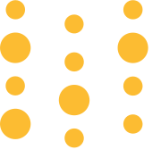

# 👋 I'm Mark!

**Startup Founder. Technical Operator. Technical Marketer.**

> A decade of taking companies from startup to scale-up to global — architecture, growth, and ops — while AI agents handle the repetitive 80%.
> This GitHub is the technical layer of that job: shipped products, agent pipelines, and systems that run themselves.

<table>
  <tr>
    <th colspan="2" align="center">
      <h2>🧭 What I Do</h2>
    </th>
  </tr>
  <tr>
    <th align="center">🧭 The Operations Layer</th>
    <th align="center">🤖 Agents & Automation</th>
  </tr>
  <tr>
    <td valign="top">
      Technical decision-making, done from inside the codebase — from hackathon prototype to 1B+-user rescue mission.  
      ✅ Architecture that won't need a rewrite 
      ✅ Ship-weekly cadence, demos that work 
      ✅ Honest buy vs. build vs. skip calls 
      ✅ Code review, cost & security passes 
      ✅ Roadmaps a non-technical founder can read
    </td>
    <td valign="top">
      Agents that do actual work, not demos.  
      ✅ LLM features users pay for 
      ✅ RAG on real data, with evals 
      ✅ Back-office agents: triage, briefs, content ops 
      ✅ Cost & quality guardrails on every model call 
      ✅ Claude/OpenAI/LangChain, open-weights when it wins
    </td>
  </tr>
  <tr>
    <th align="center">📈 Growth Engineering</th>
    <th align="center">📱 Product & Mobile</th>
  </tr>
  <tr>
    <td valign="top">
      Marketing is engineering now — I treat it that way. Agents run the pipeline; analytics decide what ships next.  
      ✅ Landing pages built to convert, not to admire 
      ✅ Privacy-first funnel measurement, day one 
      ✅ Email + CRM automation that runs itself 
      ✅ Programmatic/SEO content on agents 
      ✅ Analytics → insight → experiment, on a loop
    </td>
    <td valign="top">
      One operator, full surface area.  
      ✅ Web apps: Next.js / TypeScript / Python 
      ✅ Native iOS & macOS: Swift, shipped products 
      ✅ APIs, databases, infra that survives launch 
      ✅ Hackathon-honed speed: idea → prototype in hours
    </td>
  </tr>
</table>

<table>
  <tr>
    <th colspan="2" align="center">
      <h2>🧾 Proof, Not Promises</h2>
    </th>
  </tr>
  <tr>
    <td colspan="2">
      🌍 <strong>Off GitHub</strong> — scaled companies from <a href="https://www.markobonna.com">$5M → $55M</a>, helped rescue a fintech wallet past <strong>1B+ users</strong>, ran growth operations across <strong>6 countries</strong>, mentored <strong>20+ startups</strong> through accelerators 
      🏆 <strong>Hack FEVM winner</strong> — <a href="https://github.com/markobonna/koios">koios</a> · built on <a href="https://github.com/markobonna/anon-dao-chat">anon-dao-chat</a> at ETHGlobal Trifecta · shipped at Flow & Agentic Ethereum hackathons 
      📧 <strong>Shipped tools people use</strong> — <a href="https://github.com/markobonna/gmail-mail-merge">gmail-mail-merge</a> runs real Gmail campaigns at scale 
      ⚙️ <strong>This profile is the demo</strong> — 14 dashboards below are rebuilt nightly by CI pipelines I built. Same set-and-forget systems run the businesses. 
      📱 <strong>Products in users' hands</strong> — web + iOS apps in production 
      <a href="https://pulserelationships.com">Pulse CRM</a>, The personal CRM that tracks news, tells you who to reach out to, and drafts the message.,
      <a href="https://roads.news">Roads Intelligence</a>, the trust layer for open-source intelligence.,
      <a href="https://bottega.vip/sign-in">Bottega</a>, Bottega builds real hardware and software that instantly runs. <strong>Speak it. Build it. Fix it.</strong>,
    </td>
  </tr>
</table>

<table>
  <tr>
    <th colspan="2" align="center">
      <h2>🧰 The Toolkit I Ship With</h2>
    </th>
  </tr>
  <tr>
    <th align="center">Core Languages</th>
    <th align="center">Mobile</th>
  </tr>
  <tr>
    <td align="center">
      
      
      
      
      
      
    </td>
    <td align="center">
      
      
      
      
    </td>
  </tr>
  <tr>
    <th align="center">Frontend & Web</th>
    <th align="center">Backend & Infrastructure</th>
  </tr>
  <tr>
    <td align="center">
      
      
      
      
    </td>
    <td align="center">
      
      
      
      
      
      
    </td>
  </tr>
  <tr>
    <th align="center">Growth & Revenue Stack</th>
    <th align="center">Agent Ops</th>
  </tr>
  <tr>
    <td align="center">
      
      
      
      
      
    </td>
    <td align="center">
      
      
      
      
    </td>
  </tr>
  <tr>
    <th colspan="2" align="center">AI/ML Frameworks & Libraries</th>
  </tr>
  <td align="center" colspan="2">
    
    
    
    
    
    
    
    
    
  </td>
  <tr>
    <th colspan="2" align="center">AI Infrastructure & Data</th>
  </tr>
  <td align="center" colspan="2">
    
    
    
    
    
    
    
    
    
    
  </td>
  <tr>
    <th colspan="2" align="center">AI Services & APIs</th>
  </tr>
  <td align="center" colspan="2">
    
    
    
    
    
  </td>
</table>

<table>
  <tr>
    <th colspan="2" align="center">
      <h2>⚙️ How I Work</h2>
    </th>
  </tr>
  <tr>
    <td valign="top">
      <strong>📦 Ship weekly.</strong> Every engagement produces something demoable in 7 days. No months-long architecture phases.  
      <strong>📊 Numbers or it didn't happen.</strong> Every funnel gets instrumentation on day one; every recommendation comes with a number attached.
    </td>
    <td valign="top">
      <strong>🤖 Automate the 80%.</strong> Agents handle the repeatable work; humans (me) handle judgment, taste, and the parts customers feel.  
      <strong>🔪 Delete before optimize.</strong> The cheapest feature is the one you never build. I'll tell you what <em>not</em> to spend money on.
    </td>
  </tr>
</table>

<table>
  <tr>
    <th colspan="2" align="center">
      <h2>🏃 My Activity</h2>
    </th>
  </tr>
  <tr>
    <th align="center">📊 My GitHub Metrics</th>
    <th align="center">🈷️ Languages I Use</th>
  </tr>
  <tr>
    <td align="center">
      
    </td>
    <td align="center">
      
    </td>
  </tr>
  <tr>
    <th>📅 Isometric commit calendar</th>
    <th>📌 Habits</th>
  </tr>
  <tr>
    <td align="center">
      

Isometric commit calendar

        
      

      
    </td>
    <td align="center">
      

Habits

        
      

      
    </td>
  </tr>
  <tr>
    <th>👨‍💻 Lines of Code</th>
    <th>🎟️ Issues & Pull Requests</th>
  </tr>
  <tr>
    <td align="center">
      

Code contribution statistics

        
      

      
    </td>
    <td align="center">
      

My contribution to open source

        
      

      
    </td>
  </tr>
  <tr>
    <th>🎭 Reactions</th>
    <th>🎫 Following</th>
  </tr>
  <tr>
    <td align="center">
      

Reactions

        
      

      
    </td>
    <td align="center">
      

People I follow and follow me

        
      

      
    </td>
  </tr>
  <tr>
    <th colspan="2" align="center">
      <h3>🤝 Let's Build Something</h3>
    </th>
  </tr>
  <tr>
    <td align="center" colspan="2">
      Most of what I build lives in private repos and production — this is the part I can show. 
      The full operating record is at <a href="https://www.markobonna.com">markobonna.com</a>. Collabs, questions, or "come look under the hood":  
      
      
      
      
    </td>
  </tr>
</table>

---

  

